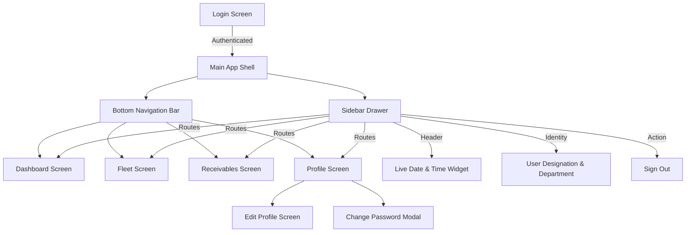

# M TRACK ERP — Mobile Design System & UI Kit (2026 Enterprise Edition)

## 1. Overview & Design Philosophy
This document serves as the single source of truth for the **M TRACK ERP** mobile design system. Any screen, dialog, component, or workflow built for the app must adhere strictly to these principles and specifications to ensure seamless visual and functional consistency.

* **Design Standard:** 2026 Enterprise FinTech & Fleet Telematics (Stripe Dashboard + Linear + Ramp aesthetic).
* **Theme Mode:** Enterprise Light Mode (High-contrast, crisp white cards, soft slate backgrounds, accessible typography).
* **Language:** Professional Corporate English throughout all screens, badges, buttons, and error messages.
* **Role Focus:** Strict role segregation. Sales role encompasses *Target Pacing, Sold Fleet, Receivables Recovery, CRM Leads, and Profile*. Support and technical workflows (*Installation Requests, After-sales Tickets, Referral Commissions*) must never leak into the sales experience.

---

## 2. Color Palette & Semantic Tokens

| Token Name | Hex Code | Compose Color | Tailwind Class | Semantic Usage |
| :--- | :--- | :--- | :--- | :--- |
| **Brand Primary** | `#2563EB` | `Color(0xFF2563EB)` | `bg-blue-600` | Primary buttons, active tabs, brand accents |
| **Brand Dark** | `#1D4ED8` | `Color(0xFF1D4ED8)` | `bg-blue-700` | Pressed states, gradient anchors |
| **Brand Light Tint** | `#EFF6FF` | `Color(0xFFEFF6FF)` | `bg-blue-50` | Active pill backgrounds, icon badges |
| **Brand Border** | `#BFDBFE` | `Color(0xFFBFDBFE)` | `border-blue-200` | Subtle active borders |
| **Surface Background**| `#F8FAFC` | `Color(0xFFF8FAFC)` | `bg-slate-50` | Primary app screen canvas |
| **Card Background** | `#FFFFFF` | `Color(0xFFFFFFFF)` | `bg-white` | White cards, dialogs, drawers |
| **Border Subtle** | `#E2E8F0` | `Color(0xFFE2E8F0)` | `border-slate-200` | Card borders, dividers, inputs |
| **Text Primary** | `#0F172A` | `Color(0xFF0F172A)` | `text-slate-900` | Main titles, numbers, bold headings |
| **Text Secondary** | `#475569` | `Color(0xFF475569)` | `text-slate-600` | Descriptions, labels, secondary info |
| **Text Muted** | `#94A3B8` | `Color(0xFF94A3B8)` | `text-slate-400` | Placeholders, timestamps, borders |
| **Emerald Success** | `#10B981` | `Color(0xFF10B981)` | `text-emerald-600` | Active vehicles, MoM growth, settled bills |
| **Emerald Tint** | `#ECFDF5` | `Color(0xFFECFDF5)` | `bg-emerald-50` | Success badges, progress fills |
| **Amber Warning** | `#F59E0B` | `Color(0xFFF59E0B)` | `text-amber-600` | Due amounts, pending setups, alerts |
| **Amber Tint** | `#FFFBEB` | `Color(0xFFFFFBEB)` | `bg-amber-50` | Due badges, pending vehicle pills |
| **Rose Error** | `#EF4444` | `Color(0xFFEF4444)` | `text-rose-600` | Overdue criticals, logout button, error toasts |
| **Hero Gradient** | Linear | `135° [#1E3A8A, #2563EB, #3B82F6]` | `from-blue-900 via-blue-600 to-blue-500` | Target pacing hero banner |

---

## 3. Typography Hierarchy
* **Primary Font Family:** Plus Jakarta Sans / Roboto / Inter
* **Data & Monospace Family:** JetBrains Mono (Vehicle plate numbers, invoice IDs, currency amounts, phone numbers).
* **Weight Rules:**
  * Titles & Headings: `FontWeight.SemiBold` (`600`) or `FontWeight.Bold` (`700`)
  * Body Text: `FontWeight.Normal` (`400`) or `FontWeight.Medium` (`500`)
  * Avoid extreme or heavy bold weights (`FontWeight.ExtraBold` or `Black`) to maintain executive cleanliness.

---

## 4. Component Standards

### 4.1 Cards & Containers
* **Border Radius:** `16dp` for standard cards, `22dp` for Bento hero banners, `12dp` for list items.
* **Card Border:** `1dp` solid `BorderSubtle` (`#E2E8F0`).
* **Elevation:** Minimal (`0.5dp` to `1dp`). Rely on clean borders and subtle shadows rather than harsh drop shadows.

### 4.2 Bento Hero Card
* Deep linear gradient (`#1E3A8A` to `#3B82F6`).
* Glassmorphic pill badges with `Color.White.copy(alpha = 0.18f)`.
* Big tabular numbers for achieved units (`FontFamily.Monospace`, `24sp-28sp`).
* Progress bar in pure white track over semi-transparent background.

### 4.3 Navigation & Pill Switchers (Linear Style)
* Container: Soft background (`#E2E8F0.copy(alpha = 0.6f)`), padding `4dp`, radius `16dp`.
* Active Pill: White card background with subtle elevation (`1dp`) and brand-colored bold text.
* Live Badges: Small pill displaying item count right next to label (e.g., `Sold Fleet 14`).

### 4.4 Search & Filters
* Capsule search text field with `Search` icon on left, `Clear` icon on right.
* Filter pills: Horizontal row of rounded capsule pills (`20dp` radius). Selected pill takes Brand Blue with white text; unselected takes white card with subtle border.

---

## 5. Screen Architecture & Navigation Routes

### Route Registry:
1. `login`: Strict authentication screen with user validation.
2. `dashboard`: Bento hero target, MoM growth engine, high-level receivables & fleet counters, month switcher.
3. `fleet`: Dedicated page for all vehicles sold by the logged-in seller, live search, plate cards, status pills, client contact.
4. `receivables`: Dedicated page for client invoice recovery, overdue days, payment ratios, 1-click **Direct Call** button.
5. `profile`: Executive user identity, sales metrics scorecard, official contacts, security.
6. `profile_edit`: Form to update name, mobile number, email, and password.

---

## 6. Sidebar Anatomy
* **Top Header:** M TRACK ERP brand logo + Title.
* **Live Date & Time Widget:** Displays real-time formatted date and 24h/12h clock (e.g. `Wednesday, 25 Nov 2026 • 09:41 AM`).
* **Profile Card:** Full name, Designation (`Sales & Marketing`), Department, and avatar circle.
* **Navigation Menu Items:**
  * Overview Dashboard (`Icons.Outlined.Dashboard`)
  * Fleet Portfolio (`Icons.Outlined.DirectionsCar`)
  * Receivables Due (`Icons.Outlined.ReceiptLong`)
  * Executive Profile (`Icons.Outlined.Person`)
  * About Company (`Icons.Outlined.Info`)
* **Footer:** 24/7 Helpline, WhatsApp Support link, and Red-accented **Sign Out** button.

---

## 7. Strict RBAC & Data Privacy Rule
* Every query made by the sales user is scoped strictly to `user_id = :current_user_id`.
* Under no circumstances shall a seller view other colleagues' sales targets, sold vehicle units, customer phone numbers, or unpaid dues.
